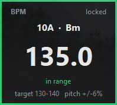

# BPM Overlay

A small always-on-top window for Windows that shows the BPM and musical key of whatever your PC is playing:
browser, Spotify, Beatport/Bandcamp/SoundCloud previews, DJ software. Use it while digging
for music to see straight away whether a track fits the tempo range of your set.

<p align="center">
  
</p>

- **Green**: the track is inside your target range
- **Amber**: a pitch-fader nudge brings it in, and the overlay says how much (e.g. `pitch +2.1% to fit`)
- **Red**: out of range, with a hint when half or double the tempo would fit
- **Key**: shown above the BPM in Camelot notation and as a key name (e.g. `8A · Am`), for harmonic mixing

It listens to your audio output directly (WASAPI loopback), so there's nothing to route
or configure.

## Install

Download `BPM-Overlay-Setup-<version>.exe` from [Releases](../../releases) and run it.
No admin rights are needed.

The app isn't code-signed yet, so Windows may warn about it:

- **SmartScreen** ("Windows protected your PC"): click **More info**, then **Run anyway**.
- **Smart App Control** may block the first launch. Trying again usually works.

## Using it

| Action | What it does |
| --- | --- |
| Left-drag | Move the overlay (its position is remembered) |
| Mouse wheel | Move the target range up/down by 1 BPM |
| Double-click | Switch between half and double tempo (e.g. 87 vs 174) |
| Right-click | Menu: audio source, target range, pitch reach, opacity, key display, reset, quit |

- **Audio source**: *Follow Windows default* (the standard setting) switches with you when you
  change outputs in Windows. You can also lock it to one device, such as your controller.
- **Target range**: type `124-130`, or a single tempo like `128`. Detection searches one
  octave around this range, the same way the BPM-range setting in DJ software works.
- **Pitch reach**: how far you're willing to pitch a track (±0–16%). This sets the amber zone.
- **Key display**: Camelot + key name, Camelot only, key name only, or hidden.

A new track takes about 4–8 seconds to settle. Readings are typically within ±0.5 BPM.

The key needs about 6 seconds of music and steadies over 15–20 seconds; it shows dimmed until
it's stable. Key detection is less certain than tempo: on test tracks it got the exact key about
70% of the time, and most misses were a neighbouring Camelot key (the relative major/minor, or
one step around the wheel), which usually still mixes fine. Treat it as a guide, especially on
tracks with little harmony.

Settings are stored in `%APPDATA%\BPMOverlay\settings.json`.

## Building from source

Requires Windows, Python 3.12 and [Inno Setup 6](https://jrsoftware.org/isinfo.php).

```powershell
pip install -r requirements.txt -r requirements-build.txt
python bpm_overlay.py              # run from source
python bpm_overlay.py --selftest   # check the tempo estimator on synthetic beats
python bpm_overlay.py --devices    # list output devices and test capture on each
.\build.ps1                        # build the app + installer\Output\BPM-Overlay-Setup-<version>.exe
```

To release a new version, bump `APP_VERSION` in `bpm_overlay.py` (the only place it's
set), run `build.ps1`, and attach the setup file to a GitHub Release. Keep the `AppId` in
`installer/BPM Overlay.iss` unchanged so new installers upgrade existing installs.

## Third-party software

The installer bundles Python, Tcl/Tk, NumPy, PyAudioWPatch (with PortAudio) and the
PyInstaller bootloader. See [installer/THIRD_PARTY_NOTICES.txt](installer/THIRD_PARTY_NOTICES.txt)
and the licence texts in [installer/licenses](installer/licenses).
